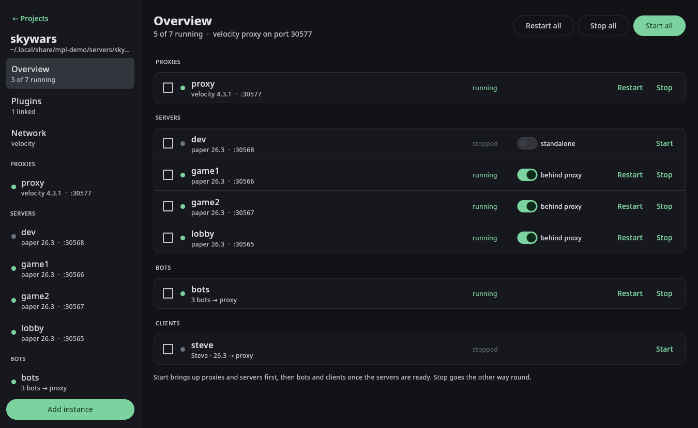
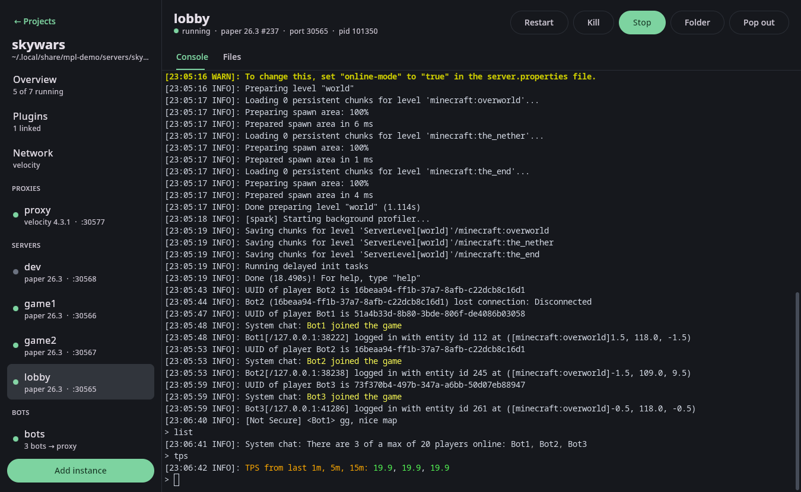
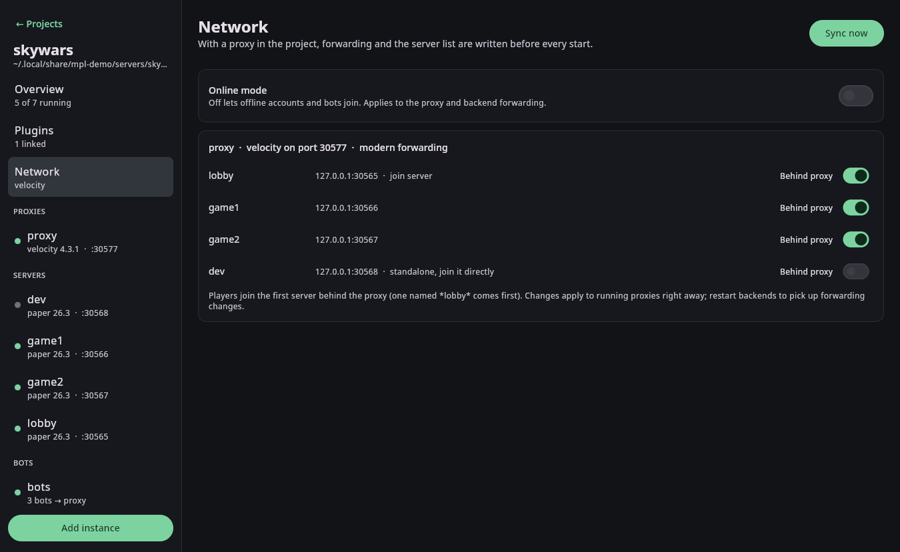
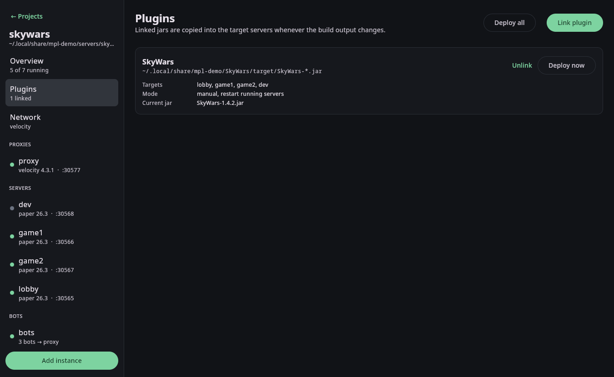
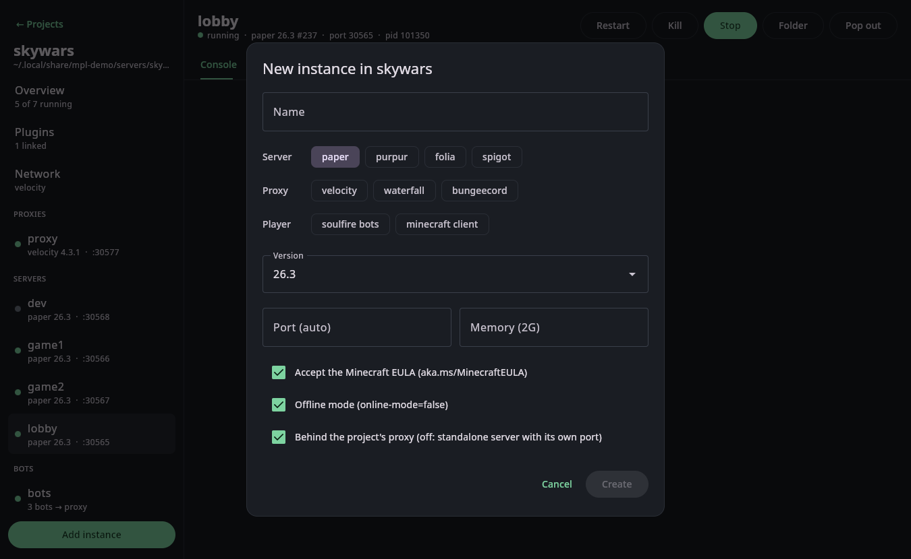
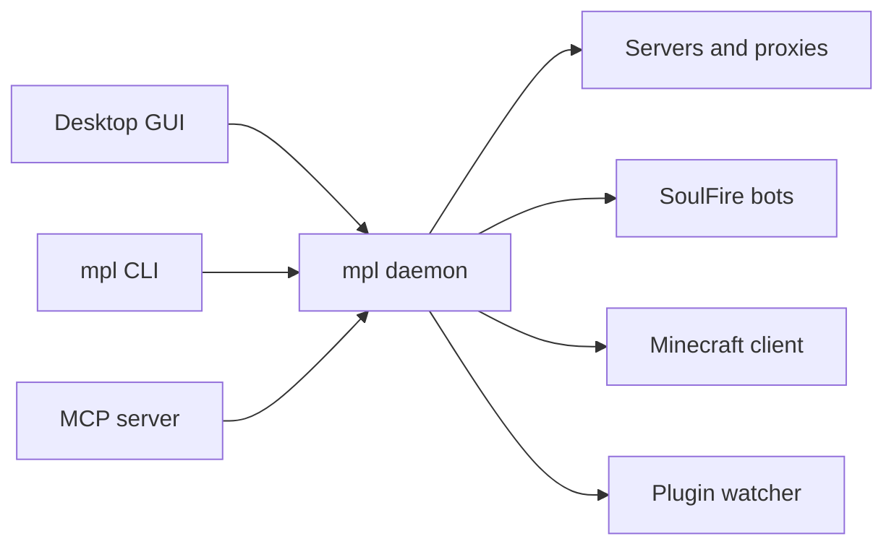

<div align="center">

# McPluginLab

**A workbench for testing Minecraft plugins.**
Servers, proxies, plugin auto-deploy, bots and a game client in one app,
driven from a desktop GUI, the command line or an AI agent.




</div>

## Why

Testing a plugin usually means juggling server folders, terminal windows, copied jars, proxy configs and a
launcher, and repeating all of it whenever the version or the setup changes. McPluginLab (`mpl`) turns that into
projects you start with one click:

- **Servers in seconds.** Paper, Purpur, Folia, Spigot (BuildTools), checksum-verified and cached. The EULA,
  offline mode and ports are set up for you.
- **Proxies that configure themselves.** Velocity, Waterfall or BungeeCord, with the server list, forwarding mode
  and secrets written on every start. Any server can be switched out of the network to run standalone.
- **Live consoles.** Real terminals with colors, tab completion and scrollback, embedded in the app or popped
  out into your own terminal. They keep running when the window closes.
- **Plugin auto-deploy.** Point a link at `target/MyPlugin-*.jar`; every build is copied to the right servers,
  old versions are removed and the servers restart.
- **Bots and a real client.** SoulFire bots and a built-in offline Minecraft launcher join your network
  automatically.
- **The right Java, automatically.** Each instance runs on the Java version it needs; missing JDKs are
  downloaded from Adoptium.
- **Built for AI testing.** An MCP server lets agents like Claude Code start the network, send commands, drive
  bots and wait for log lines, the same way you do.

<table>
<tr>
<td></td>
<td></td>
</tr>
<tr>
<td align="center">Embedded console</td>
<td align="center">Proxy network with standalone servers</td>
</tr>
<tr>
<td></td>
<td></td>
</tr>
<tr>
<td align="center">Linked plugins</td>
<td align="center">Adding a server, proxy, bots or client</td>
</tr>
</table>

## Quick start

Requirements: Linux and a JDK 21 or newer to build and run `mpl`. Server JDKs are handled for you.

```bash
git clone <this repository> McPluginLab && cd McPluginLab
./gradlew installDist
alias mpl=$PWD/cli/build/install/mpl/bin/mpl

mpl gui
```

Or the same from the command line:

```bash
mpl project create skywars
mpl create skywars/proxy -t velocity
mpl create skywars/lobby -t paper -v 26.3
mpl create skywars/game1 -t paper -v 26.3
mpl create skywars/dev   -t paper -v 26.3 --standalone          # outside the proxy network
mpl create skywars/bots  -t soulfire --target proxy --count 3
mpl plugin add -P skywars SkyWars ~/SkyWars/target/SkyWars-*.jar

mpl up skywars                                                  # proxy and servers, then the bots
mpl bot skywars/bots -b Bot1 say /sw join --expect 'Bot1 issued server command' --expect-in skywars/lobby
mpl attach skywars/lobby                                        # Ctrl+] detaches
mpl down skywars
```

Now run `mvn package` in your plugin: the new jar is deployed and the servers restart by themselves.

## Let an AI agent test your plugin

```bash
claude mcp add mpl -- /path/to/McPluginLab/cli/build/install/mpl/bin/mpl mcp
```

The agent gets tools such as `start_project`, `deploy_plugins`, `send_command` and `bot_command` with `expect`,
`wait_for_log` and `read_log` with cursors, so it can run a full test loop: build, deploy, join with bots,
trigger the feature and check the server log. See [AI agents](docs/ai-agents.md).

## Documentation

| | |
|---|---|
| [Getting started](docs/getting-started.md) | Install, first project, a tour of the GUI |
| [Networks](docs/networks.md) | Proxies, forwarding, standalone servers |
| [Plugins](docs/plugins.md) | Linking build output and auto-deploy |
| [Bots and clients](docs/bots-and-clients.md) | SoulFire bots and the built-in launcher |
| [AI agents](docs/ai-agents.md) | The MCP server and an example test loop |
| [CLI reference](docs/cli.md) | Every `mpl` command |
| [Architecture](docs/architecture.md) | Daemon, clients, files and the HTTP API |

## How it works

A small background daemon owns every process. The GUI, the CLI and the MCP server are thin clients that talk to
it over a local HTTP and WebSocket API, so they all see the same live state. Servers keep running when you close
the window, and you can watch a console in the app while an agent drives the same server through MCP.



## Supported software

| Type | Versions from | Notes |
|---|---|---|
| Paper, Folia, Velocity, Waterfall | PaperMC API | sha256 verified |
| Purpur | Purpur API | |
| Spigot | BuildTools | built once per version, then cached |
| BungeeCord | md_5 Jenkins | |
| SoulFire | GitHub releases | or your own SoulFireCLI jar |
| Minecraft client | Mojang manifest | offline accounts |

## Building from source

```bash
./gradlew installDist   # build the mpl distribution
./gradlew test          # run the tests
```

Rebuilding while `mpl` runs is safe: the daemon and the GUI run from a private copy of the jars.
Run `mpl shutdown` to restart the daemon on a new build. Running servers are stopped first.
