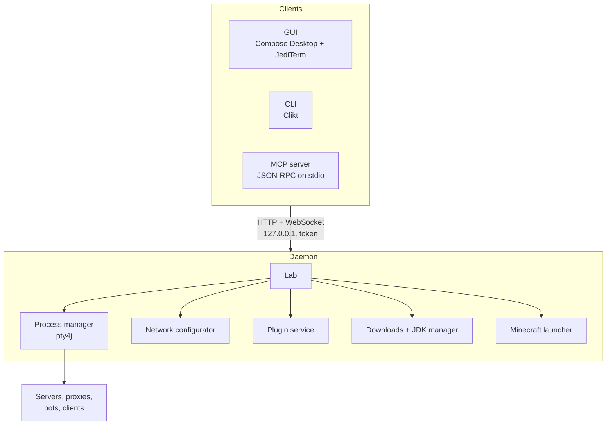

# Architecture

## Processes



The daemon is started on demand by the first client. It writes `daemon.json` (port, token, pid, build) into
`MPL_HOME` and holds `daemon.lock` so only one daemon runs per workspace. The build ID is a hash of McPluginLab's own jars (built
reproducibly), so it changes only when the code does. A client from a different build restarts an idle daemon
on its own build; when instances are running it warns instead, because restarting stops them.

The daemon and the GUI run from a copy of the jars in `MPL_CACHE/runtime/<build>`, so rebuilding McPluginLab
never pulls classes out from under a running process. Copies still in use are kept; older ones are removed.

## Modules

| Module | Contents |
|---|---|
| `api` | Shared model, `MplClient` (HTTP/WebSocket client), daemon discovery and start-up |
| `core` | `Lab` (projects and instances), processes, downloads, JDKs, network config, plugin links, SoulFire, launcher |
| `daemon` | Ktor CIO server exposing `core` |
| `gui` | Compose Desktop app; consoles are JediTerm widgets connected over WebSocket |
| `mcp` | MCP server and tools |
| `cli` | `mpl` entry point for every command, including `gui`, `mcp` and `daemon` |

## Instances and consoles

Every instance runs in its own pseudo-terminal, so programs see a real terminal: colors, JLine prompts and tab
completion work. The daemon keeps:

- a raw output buffer for attaching consoles with scrollback (GUI, `mpl attach`, **Pop out**),
- a line log with sequence numbers, which `logs`, `wait`, `read_log` and every `expect` use as cursors,
- a log file per instance in `MPL_HOME/logs/<project>/<name>.log`.

An instance is `starting` until its ready line appears (`Done (…)!` for servers, `Listening on` for BungeeCord,
loaded accounts for SoulFire, the session line for clients) and then `running`.

## Storage

```
MPL_HOME/
  daemon.json, daemon.lock
  projects/<project>/project.yaml            # folder, online mode, secret, plugin links
  projects/<project>/instances/<name>.yaml   # type, version, folder, port, memory, Java, bots, client
  logs/<project>/<name>.log
MPL_CACHE/
  jars/  jdks/  minecraft/  runtime/
```

The YAML files are plain and can be edited while the daemon is stopped.

## HTTP API

All routes are under `/api` and need `Authorization: Bearer <token>` (or `?token=` for WebSockets).

| Route | |
|---|---|
| `GET /projects`, `POST /projects`, `PATCH /projects/{p}`, `DELETE /projects/{p}` | Projects |
| `POST /projects/{p}/start\|stop\|restart` | Group actions (`{"instances": [], "wait": false}`) |
| `GET\|POST /projects/{p}/plugins`, `DELETE /projects/{p}/plugins/{name}`, `POST /projects/{p}/deploy` | Plugin links |
| `POST /projects/{p}/network/sync` | Network config |
| `GET /instances`, `POST /projects/{p}/instances` | List and create instances |
| `GET\|PATCH\|DELETE /projects/{p}/instances/{n}` | One instance |
| `POST …/start\|stop\|restart\|kill` (`?wait=`), `POST …/command` | Lifecycle and console input |
| `GET …/log?since=&limit=&waitMs=`, `GET …/wait?pattern=&since=&timeoutMs=` | Log lines and waiting |
| `GET …/files?path=`, `GET\|PUT …/file` | Files |
| `WS …/attach`, `WS /events` | Console stream and state events |
| `GET /versions/{software}`, `GET /java`, `GET /ping`, `POST /shutdown` | Misc |
