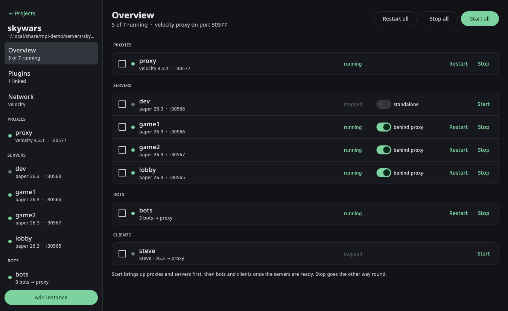

# Getting started

## Install

McPluginLab runs on Linux and needs a JDK 21 or newer for itself. Servers, proxies, bots and clients get the Java
version they need automatically (see [Java](#java)).

```bash
git clone <this repository> McPluginLab && cd McPluginLab
./gradlew installDist
```

The distribution is in `cli/build/install/mpl`. Put its `bin` folder on your `PATH` or add an alias:

```bash
alias mpl=/path/to/McPluginLab/cli/build/install/mpl/bin/mpl
```

`mpl desktop` adds McPluginLab with its icon to your application menu.

The first `mpl` command starts the background daemon. You never have to start it yourself. Closing the window
stops the daemon too when nothing is running; when instances are running it asks whether to keep them running
in the background or stop everything. `mpl shutdown` turns everything off from the terminal. After you rebuild
McPluginLab, the next command restarts an idle daemon on the new build automatically; if instances are running,
the GUI offers **Restart daemon** instead (the CLI asks you to run `mpl shutdown`).

## Concepts

- **Project**: a group of instances you test together, usually one per plugin or network setup. Each project
  has a folder that holds its server directories.
- **Instance**: one server, proxy, bot group or game client. Instances are addressed as `project/name`.
- **Plugin link**: a jar, glob or folder from your build output, plus the instances that should receive it.

## Your first project in the GUI

1. Run `mpl gui` and click **New project**. Leave the folder empty to use the default location, or pick one
   next to your plugin sources.
2. Open the project and click **Add instance**. Add a `velocity` proxy and two `paper` servers named `lobby`
   and `game1`. Server jars are downloaded and cached, the EULA is accepted and offline mode is enabled.
3. On the **Overview** page click **Start all**. Proxies and servers start first; bots and clients start once
   the servers are ready.
4. Click a server in the sidebar to open its console. Type commands directly; **Pop out** opens the same console
   in a terminal window (`MPL_TERMINAL`, default `konsole`).
5. On **Plugins**, click **Link plugin** and choose your plugin jar. The name and a version glob such as
   `MyPlugin-*.jar` are filled in. From now on every build is deployed automatically.



### Pages

| Page | What it does |
|---|---|
| Overview | State of every instance; start, stop and restart all, a selection, or one instance; switch servers in or out of the proxy |
| Plugins | Linked jars, their targets, the current build and the last deploy |
| Network | Proxy type, forwarding mode, online mode and which servers are behind the proxy |
| Instance → Console | The live console, with scrollback |
| Instance → Files | Browse the server folder and edit configs with syntax highlighting |

## Your first project from the command line

```bash
mpl project create demo
mpl create demo/proxy -t velocity
mpl create demo/lobby -t paper            # latest stable Paper
mpl up demo
mpl ls
mpl send demo/lobby list --expect 'players online'
mpl logs demo/lobby -f
mpl down demo
```

Instead of `project/name` you can pass `-P project` or set `MPL_PROJECT` and use bare names.

## Importing existing servers

Keep an existing server folder and jar:

```bash
mpl create demo/old --dir ~/servers/old --jar paper-1.21.4.jar -v 1.21.4
```

To move a project's folders somewhere else later (all instances must be stopped):

```bash
mpl project set demo --dir ~/work/demo-servers
```

## Java

Each instance picks a JDK by itself (`java: auto`):

| Instance | Java |
|---|---|
| Paper, Folia, Purpur | the minimum the build requires |
| Other servers | 8 up to 1.16, 17 up to 1.20.4, 21 from 1.20.5, 25 for 26.x |
| Proxies | 21 |
| SoulFire | 25 |
| Client | what Mojang's version manifest asks for |

Installed JDKs in `~/.jdks`, `/usr/lib/jvm` and sdkman are used when the major version matches exactly.
Otherwise Temurin is downloaded from Adoptium into the cache. `mpl java` lists what is available, and
`mpl create --java /path/to/java` pins a specific executable.

## Where things are

| Path | Contents |
|---|---|
| `~/.local/share/mcpluginlab` (`MPL_HOME`) | projects, instance definitions, console logs, daemon info |
| `~/.cache/mcpluginlab` (`MPL_CACHE`) | server jars, JDKs, Minecraft files, runtime copies of `mpl` |
| project folder | one directory per instance; default `~/.local/share/mcpluginlab/servers/<project>` |

Both base paths follow `XDG_DATA_HOME` and `XDG_CACHE_HOME`.
