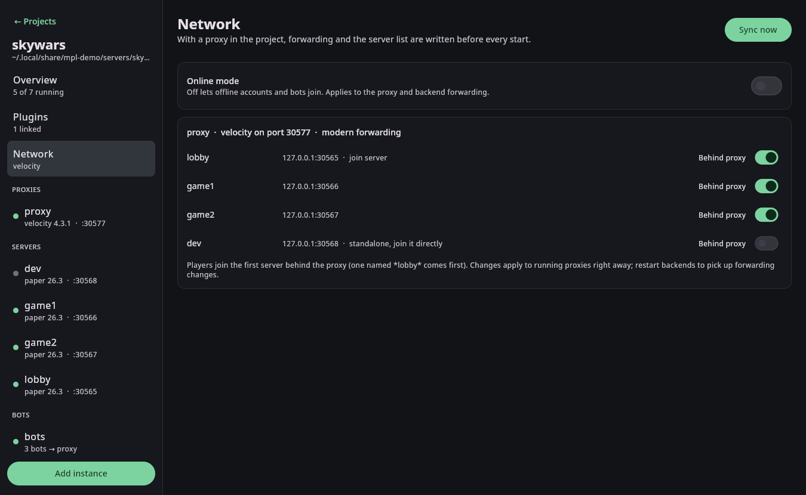

# Networks

A project becomes a network as soon as it contains a proxy (`velocity`, `waterfall` or `bungeecord`). Before an
instance starts, and whenever instances are added, removed or switched in or out of the network, mpl writes
the proxy and backend configuration. You never edit forwarding settings by hand.



## What gets written

**Velocity** (`velocity.toml`)
- `bind` on the proxy's port, `online-mode` from the project setting
- `[servers]` with every server behind the proxy and `try` listing them; a server whose name contains `lobby` comes first
- `player-info-forwarding-mode` and a per-project `forwarding.secret`

**BungeeCord and Waterfall** (`config.yml`)
- `servers`, a listener on the proxy's port with `priorities` (lobby first) and `force_default_server: true`,
  so players always land on the lobby
- `ip_forward: true`, `online_mode` from the project setting

**Backends**
- `server.properties`: `online-mode=false` and `server-port`
- Modern forwarding: `config/paper-global.yml` → `proxies.velocity` enabled with the project secret
- Legacy forwarding: `spigot.yml` → `settings.bungeecord: true`

Edits keep the rest of each file, including comments.

## Forwarding mode

| Proxy | Backends | Mode |
|---|---|---|
| Velocity | all Paper, Folia or Purpur 1.13+ | modern |
| Velocity | any Spigot or older server | legacy (BungeeCord) |
| BungeeCord, Waterfall | any | legacy |

The Network page shows the mode in use.

## Standalone servers

Sometimes you want a server outside the network next to it, for example a single server to test your plugin's
non-network mode. Turn off **Behind proxy** on the Overview or Network page, or:

```bash
mpl create demo/solo -t paper --standalone   # when creating
mpl set demo/solo --proxied false            # later
```

A standalone server is removed from the proxy's server list (a running Velocity proxy reloads at once), and its
forwarding is turned off so players can join it directly on its own port. Turn the switch back on to rejoin the
network. Restart a backend after switching so it picks up the forwarding change.

## Online mode

Projects run in offline mode by default so bots and offline clients can join. Turn on **Online mode** on the
Network page or run `mpl project set demo --online-mode true` to require Mojang authentication at the proxy.

## Syncing by hand

`mpl network sync -P demo` (or **Sync now**) writes everything immediately and reloads a running proxy.
