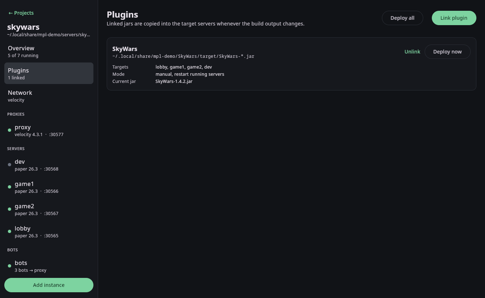

# Plugins

A plugin link connects your build output to the servers that should run it.



## Linking

In the GUI: **Plugins → Link plugin**, then browse to the built jar. The version part of the file name is
replaced with `*` (for example `MyPlugin-1.4.2.jar` becomes `MyPlugin-*.jar`), so every future version matches.

From the command line:

```bash
mpl plugin add -P demo MyPlugin ~/MyPlugin/target/MyPlugin-*.jar -t lobby -t game1
mpl plugin add -P demo MyProxyPlugin ~/MyPlugin/proxy/target/MyProxyPlugin-*.jar -t proxy
mpl plugin ls -P demo
```

A source can be:

| Source | Picks |
|---|---|
| a jar path | that file |
| a glob such as `target/MyPlugin-*.jar` | the newest matching jar |
| a folder | the newest jar in it |

Jars ending in `-sources`, `-javadoc` or `-tests` and Maven Shade's `original-*` jars are ignored.
Without `-t`, a link targets every server in the project.

## Deploying

- **Automatically**: the source is checked every two seconds. Once a new jar has stopped changing, it is copied
  into each target's `plugins/` folder, older versions of the same plugin are removed and running targets
  restart. Use `--manual` to turn this off and `--no-restart` to only copy.
- **Now**: **Deploy now** / **Deploy all** in the GUI, `mpl deploy -P demo [MyPlugin]`, or the
  `deploy_plugins` MCP tool.

Each deploy is noted in the target's console as `[mpl] deployed MyPlugin-1.4.3.jar`.

## Other plugins

Plugins you do not build yourself, such as PlaceholderAPI or LuckPerms, can simply be put into a server's
`plugins/` folder (**Folder** opens it). Config files can be edited on the instance's **Files** tab or with
`mpl file cat` and `mpl file write`.
